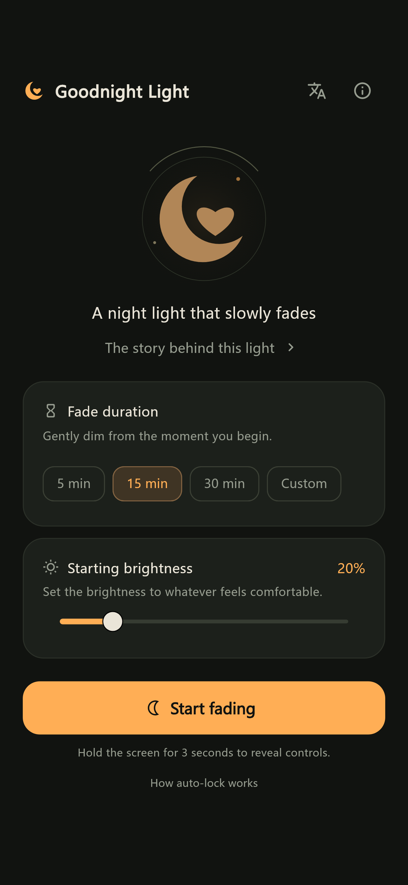
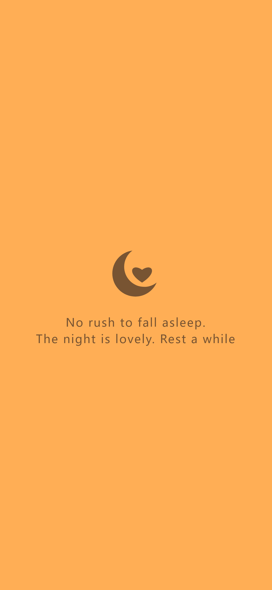
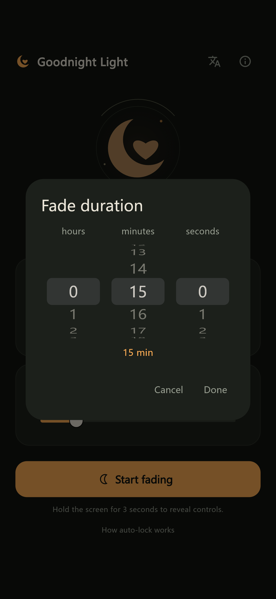

# Goodnight Light · 晚安灯

English · [简体中文](README.md)

A warm screen light that gently fades into darkness, giving you a little time to settle in.

I made this while putting my child to bed. Switching off the light felt too dark, while leaving it on was too bright. This small light begins dimming as soon as it starts and gradually reaches a black screen. I hope it makes your nights a little more comfortable, too.

Built with Flutter for Android and iOS. Choose English, Simplified Chinese, or the system language in the app.

## Preview

| Duration and brightness | While fading | Custom duration |
| --- | --- | --- |
|  |  |  |

These are Flutter-rendered previews. Physical brightness varies by device.

## Features

- A warm screen light with adjustable starting brightness and a smooth fade.
- A 15-minute default, 5/15/30-minute presets, and custom hours, minutes, and seconds.
- Keeps the screen awake during the fade. Long-press the running screen to reveal stop controls.
- Restores the original brightness when switching apps or locking the phone. Returning continues or completes the session according to elapsed time.
- Stores duration, brightness, language, and introduction preferences locally.
- Works offline with no accounts, ads, analytics, or tracking. The privacy policy link opens in the system browser.

After the screen becomes black, the phone's auto-lock settings determine when the display switches off. Enable auto-lock and adjust Always-On Display as needed. LCD screens may retain a faint backlight until the display turns off. This is a comfort light for everyday use, not a sleep treatment.

## Download and source version

[View Goodnight Light on the App Store](https://apps.apple.com/app/id6822552024). Availability depends on your storefront.

This open-source snapshot is version `1.0.5+11`. The Dart package retains the name `amber_night`. Build Android locally using the instructions below.

## Development

The project uses Flutter **3.47.7 stable** and JDK **17**. Android builds require the Android SDK. iOS builds require macOS and Xcode, with an iOS deployment target of 15.0.

```sh
git clone https://github.com/yangwagongjuren-ship-it/goodnight-light.git
cd goodnight-light
flutter pub get
flutter analyze
flutter test
flutter run
```

Build an Android debug APK at `build/app/outputs/flutter-apk/app-debug.apk`.

```sh
flutter build apk --debug
```

On macOS, build for the iOS simulator.

```sh
flutter build ios --simulator --debug
```

To run on an iPhone, open `ios/Runner.xcworkspace` in Xcode and select your own development team and signing configuration. For your own distribution, change the Android application ID and iOS Bundle ID and update the privacy policy URL. Use `android/key.properties.example` as a template for local Android release signing credentials.

On Windows, the included helper handles paths containing non-ASCII characters.

```powershell
powershell -File scripts/dev.ps1 check
powershell -File scripts/dev.ps1 apk
```

## Code and verification

Automated tests and Android/iOS build verification for this public snapshot are pending. Commands and verification workflows are provided below.

| Path | Contents |
| --- | --- |
| `lib/main.dart` | UI, language selection, and user flow |
| `lib/night_light.dart` | Timing, fading, state, and device interface |
| `lib/strings.dart` | English and Chinese copy |
| `android/app/src/main/kotlin/` | Android brightness and local preferences |
| `ios/Runner/` | iOS brightness and lifecycle handling |
| `test/` | Logic and widget tests |
| `integration_test/` | Device and simulator integration tests |

See the [architecture](docs/ARCHITECTURE.md) and [device checklist](docs/DEVICE_TESTS.md) for implementation details and physical-device checks. Validate physical brightness and auto-lock behavior on your target devices.

GitHub Actions supports pull requests and manual verification, including Flutter analysis, tests, Android debug builds, and iOS compilation. With a connected device, run the complete integration flow.

```sh
flutter test integration_test/night_flow_test.dart -d <device-id>
```

`test/render_previews_test.dart` is an optional Windows preview exporter. It is skipped by default and depends on local fonts and a `.tooling/flutter` SDK path.

## Contributing and license

Issues and pull requests in English or Chinese are welcome. See [CONTRIBUTING.md](CONTRIBUTING.md).

Source code and original assets in this repository are available under the [MIT License](LICENSE). Flutter and other third-party components retain their own licenses. Use your own app identity and developer details when distributing a fork.
