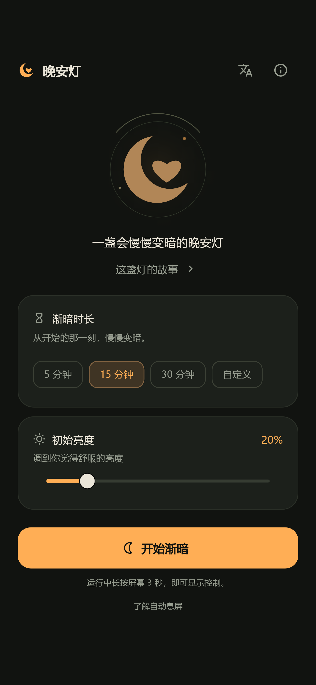
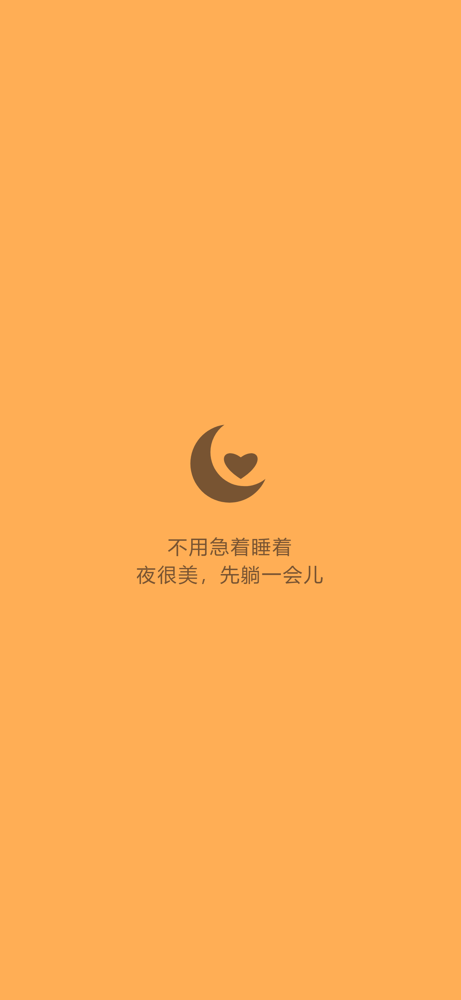
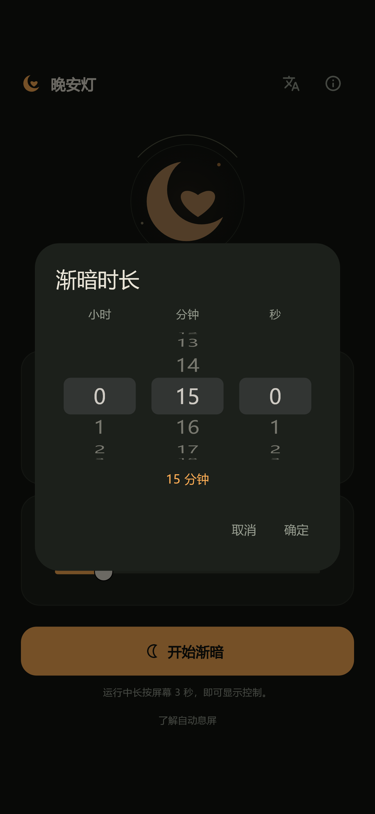

# 晚安灯 · Goodnight Light

[English](README.en.md) · 简体中文

一盏会慢慢变暗的晚安灯。用手机屏幕留一点暖光，给你一点适应黑暗的时间。

陪孩子睡觉时，关灯怕黑，留灯又太亮，于是有了这个小工具。它从开始的那一刻持续渐暗，直到画面变成纯黑。希望这一点光，也能让你的夜晚舒服一些。

基于 Flutter，支持 Android 和 iOS。应用界面可选简体中文、English 或跟随系统。

## 界面预览

| 设置时长和亮度 | 渐暗中的陪伴 | 自定义时长 |
| --- | --- | --- |
|  |  |  |

以上为 Flutter 渲染预览，实际亮度取决于设备。

## 功能

- 暖色屏幕灯，可调整初始亮度，开始后平滑渐暗。
- 默认 15 分钟，提供 5、15、30 分钟快捷选项，也可按小时、分钟和秒自定义。
- 渐暗时保持屏幕唤醒，长按运行画面可显示停止控制。
- 切换应用或锁屏时恢复原亮度，返回后根据实际经过的时间继续或结束。
- 在手机上保存时长、亮度、语言和首次使用说明的阅读状态。
- 完全离线使用，无账号、广告、统计或追踪。隐私政策链接通过系统浏览器打开。

画面变黑后，手机由系统自动锁定设置控制息屏。请开启自动锁定，并按需要关闭息屏显示。LCD 屏幕在真正息屏前可能仍有背光。这款应用用于日常陪伴，不提供睡眠治疗。

## 下载与源码版本

[在 App Store 查看晚安灯](https://apps.apple.com/app/id6822552024)。可下载地区以商店页面为准。

本次开源源码版本为 `1.0.5+11`，Dart 包名沿用 `amber_night`。Android 可按下方步骤自行构建。

## 开发与运行

项目使用 Flutter **3.47.7 stable**，JDK **17**。Android 构建需要 Android SDK，iOS 构建需要 macOS 和 Xcode，iOS 最低版本为 15.0。

```sh
git clone https://github.com/yangwagongjuren-ship-it/goodnight-light.git
cd goodnight-light
flutter pub get
flutter analyze
flutter test
flutter run
```

构建 Android 调试包，输出为 `build/app/outputs/flutter-apk/app-debug.apk`。

```sh
flutter build apk --debug
```

在 macOS 编译 iOS 模拟器版本。

```sh
flutter build ios --simulator --debug
```

安装到 iPhone 时，在 Xcode 打开 `ios/Runner.xcworkspace`，选择自己的开发团队并配置签名。用于自己的发行版本时，请更换 Android application ID 和 iOS Bundle ID，并更新隐私政策地址。Android 正式签名可参考 `android/key.properties.example`，凭据保存在本地。

Windows 上若中文路径影响工具运行，可使用附带脚本。

```powershell
powershell -File scripts/dev.ps1 check
powershell -File scripts/dev.ps1 apk
```

## 代码与验证

本次公开版本的自动化测试与双端构建验证尚未完成。下方提供复现命令与验证流程。

| 路径 | 内容 |
| --- | --- |
| `lib/main.dart` | 界面、语言选择和使用流程 |
| `lib/night_light.dart` | 计时、渐暗、状态和设备接口 |
| `lib/strings.dart` | 中英文文案 |
| `android/app/src/main/kotlin/` | Android 屏幕亮度与本地设置 |
| `ios/Runner/` | iOS 屏幕亮度与生命周期处理 |
| `test/` | 逻辑测试和界面测试 |
| `integration_test/` | 真机或模拟器集成测试 |

更多实现细节见 [技术设计](docs/ARCHITECTURE.md)，设备验收项目见 [设备测试表](docs/DEVICE_TESTS.md)。物理亮度和系统锁屏行为需在目标设备上验证。

GitHub Actions 支持 PR 验证及手动运行，包含 Flutter 分析、测试、Android 调试构建和 iOS 编译。完整的设备流程可在连接设备后执行。

```sh
flutter test integration_test/night_flow_test.dart -d <device-id>
```

`test/render_previews_test.dart` 为可选的 Windows 预览导出工具，默认跳过，依赖本机字体和 `.tooling/flutter` 路径。

## 参与和许可

欢迎提交中文或英文 Issue 和 Pull Request，参与方式见 [贡献说明](CONTRIBUTING.md)。

源码及本仓库原创素材采用 [MIT 许可证](LICENSE)。Flutter 和其他第三方组件遵循各自许可证。自行发行时请使用自己的应用身份和开发者资料。
